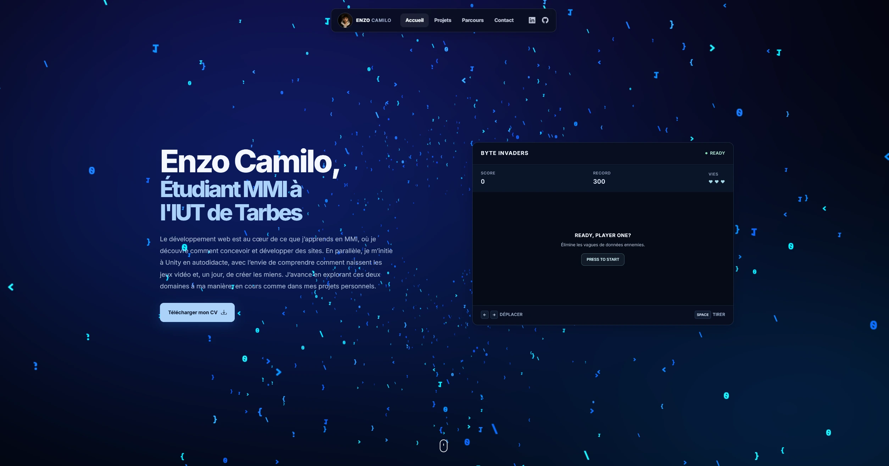

# Portfolio - Enzo Camilo

Portfolio personnel d’Enzo Camilo, étudiant en BUT Métiers du Multimédia et de l’Internet (MMI) à l’IUT de Tarbes.

Ce projet présente mon parcours, mes compétences et mes réalisations. Je l’ai conçu comme une expérience immersive qui associe développement web, animation et interactivité, tout en me permettant d’expérimenter de nouvelles techniques.

**[Découvrir le portfolio](https://enzo131106.github.io/Portfolio/)**



## Fonctionnalités

- Fond spatial en 3D réalisé avec Three.js.
- Navigation immersive et transitions liées au défilement avec GSAP et ScrollTrigger.
- Carrousel interactif des projets avec rotation automatique, navigation manuelle et commande de pause.
- Frise chronologique du parcours scolaire et professionnel.
- Mini-jeu **Byte Invaders** intégré à la page d’accueil : score, record local, partage et export du score au format PNG.
- Interface responsive, adaptée aux différentes tailles d’écran.

## Technologies utilisées

| Technologie | Utilisation |
| --- | --- |
| HTML5 | Structure et contenu des pages |
| CSS3 | Mise en page, responsive et animations |
| JavaScript | Interactions, navigation et logique du mini-jeu |
| Bootstrap et Bootstrap Icons | Composants, utilitaires et icônes |
| Three.js | Rendu du fond spatial en WebGL |
| GSAP et ScrollTrigger | Animations et transitions au défilement |
| Canvas 2D | Rendu de Byte Invaders |
| GitHub Pages | Hébergement du site statique |

Le site ne nécessite ni serveur applicatif, ni base de données, ni étape de compilation. Les bibliothèques utilisées sont incluses dans le dépôt.

## Consulter le projet localement

Pour consulter et étudier le projet en local, avec Git et Python 3 installés :

```bash
git clone https://github.com/Enzo131106/Portfolio.git
cd Portfolio
python -m http.server 8000
```

Ouvrir ensuite [http://localhost:8000](http://localhost:8000) dans un navigateur récent. Selon l’installation de Python, la commande peut être `python3 -m http.server 8000` ou `py -m http.server 8000`.

Un serveur HTTP local est recommandé plutôt qu’une ouverture directe du fichier `index.html`, notamment pour le chargement des modules JavaScript.

## Organisation du projet

```text
Portfolio/
├── assets/
│   ├── css/          # Feuilles de style
│   ├── documents/    # Documents du portfolio
│   ├── icons/        # Logo, icônes et notices
│   ├── images/       # Images et captures des projets
│   └── js/           # Scripts et interactions
├── vendor/           # Bibliothèques tierces et licences
├── index.html        # Page principale
├── privacy.html      # Confidentialité et fonctionnement
├── mentions-legales.html
├── 404.html          # Page d’erreur
├── sitemap.xml       # Plan du site pour les moteurs de recherche
├── LICENSE
└── README.md
```

## Qualité web et confidentialité

Le projet intègre plusieurs bonnes pratiques de développement web :

- Structure HTML sémantique, libellés accessibles, navigation au clavier et indicateurs de focus.
- Prise en compte de la préférence de réduction des animations et possibilité de mettre en pause le carrousel.
- Ressources principales hébergées localement, images aux formats AVIF et WebP et chargement différé des images de projets.
- Politique de sécurité du contenu (CSP) et contrôle d’intégrité de certaines bibliothèques (SRI).
- URL canoniques, métadonnées et sitemap XML.
- Aucun cookie de suivi ni outil de mesure d’audience. Le stockage local conserve la fermeture du message de confidentialité et le meilleur score à Byte Invaders.

La police Inter peut être chargée via Bunny Fonts sur la page principale ; une solution de repli locale est prévue.

Consulter la [politique de confidentialité](https://enzo131106.github.io/Portfolio/privacy.html) et les [mentions légales](https://enzo131106.github.io/Portfolio/mentions-legales.html) pour plus de détails.

## Droits et licences

**Copyright © 2026 Enzo Camilo — Tous droits réservés.**

Le code source est publiquement consultable à des fins d’information et d’apprentissage. Les conditions de réutilisation des créations originales sont précisées dans le fichier [LICENSE](LICENSE). Ce dépôt n’est pas distribué sous une licence open source.

Les bibliothèques et ressources tierces restent régies par leurs propres licences, disponibles dans le dossier [vendor/](vendor/) et les [notices d’attribution](assets/icons/skills/NOTICE.txt).

## Contact

**Enzo Camilo** — Étudiant en BUT MMI à l’IUT de Tarbes

[Portfolio](https://enzo131106.github.io/Portfolio/) · [LinkedIn](https://www.linkedin.com/in/enzo-camilo-4190a939b/) · [GitHub](https://github.com/Enzo131106) · [E-mail](mailto:enzo.camilo1306@gmail.com)
